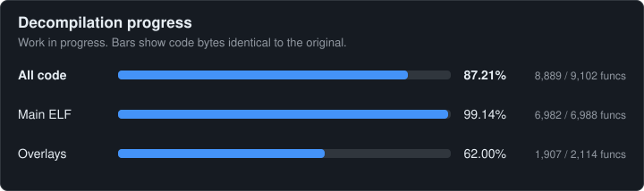

# kh1-decomp

A matching decompilation of **Kingdom Hearts** (PS2, 2002). The native PS Vita
port built from this code lives in its own repository,
[kh1-vita](https://github.com/ShayVD/kh1-vita), which uses this one as a submodule.
Docs here that name `host/`, `tools/host/`, `tools/vu/`, `tools/vita/`, `tests/host/` or
the `vita-*` and `native-*` docs mean paths in kh1-vita, where those files moved.

Target: **Kingdom Hearts Final Mix**, main executable `SLPS_251.98`
(SHA-256 `1993a4da…`, pinned in `kh1.toml`). See
[docs/target-versions.md](docs/target-versions.md) for why.

[](docs/progress.md)

**Work in progress.** The bars count code that matches the original byte for byte
(main ELF plus the 12 EE overlays), not how playable anything is; the native Vita port
is further behind. Details by phase: [docs/progress.md](docs/progress.md).
`docs/progress.svg` is generated from committed files by `make progress-badge`, and the
`progress` workflow commits it when a push to `main` changes the numbers, with no game data or secrets.

## No game data in this repository

This repository contains **code only**. It never contains the game's ELF,
disc images, or any data ripped from the disc: no textures, models, audio,
text, or tables. You need your own legally dumped copy of the game, and you
provide its executable locally at build time. `.gitignore` refuses the usual
file names and `tools/check_no_assets.sh` (run by CI, and usable as a
pre-commit hook) rejects ELF binaries, disc images and large blobs. Pull
requests that add game data will be closed.

## Setup

Linux (or WSL) with python3 ≥ 3.11, make, curl:

```sh
sudo dpkg --add-architecture i386 && sudo apt-get update
sudo apt-get install libc6:i386 libstdc++5:i386 binutils-mips-linux-gnu
make toolchain          # fetches ee-gcc + objdiff-cli into tools/toolchain/
make test               # self-tests on a synthetic ELF, no game needed
```

Copy the main executable from the root of your own disc into the repo root
(for Final Mix: `SLPS_251.98`), then:

```sh
make check              # confirms your file is the pinned version
make                    # build + byte-for-byte verify
```

## How the build works

Same model as the [GovanifY/kh2](https://github.com/GovanifY/kh2) decomp:

- `layout.tsv` lists every function in the original ELF (`make layout`
  regenerates it; hand fixes are fine).
- `functions.tsv` maps symbol names (or C++ signatures) to addresses.
- Every file in `src/` is compiled with the original compiler and
  `-ffunction-sections`. Each function is linked at its original address,
  everything it calls or reads resolves to original addresses, and its bytes
  are patched into a copy of the original ELF (`out/kh1.elf`).
- `make verify` passes only if that copy is byte-identical to the original.
- `make objdiff` writes `objdiff.json` for the [objdiff](https://github.com/encounter/objdiff)
  GUI; `make report` prints objdiff's per-function match.

A function is **done** only when it is byte-identical and objdiff reports
100%. Anything else is a candidate and lives in `nonmatchings/`.

## Workflow

See [docs/workflow.md](docs/workflow.md) for the tools: `make rank` (easiest
functions first), `kh1tool.py asm`/`m2c` (original asm and a first-draft C),
`tools/autodecomp.py` (bulk matching of m2c output with a permutation
search), `tools/sigs.py` (guessed prototypes), `tools/structs.py` (struct
recovery), and how rodata (switch tables, strings) is placed.

1. Pick a function with `make rank` (start with small leaf functions).
2. Write it in a file under `src/`, named `func_XXXXXXXX` or registered in
   `functions.tsv`. Reference undecompiled code and data as `func_XXXXXXXX` /
   `D_XXXXXXXX` (declare them `extern "C"` from C++).
3. `make objdiff`, open the repo in objdiff, iterate until 100%.
4. `make` must still pass. Commit.
5. End of session: `make progress-update SESSION=N` and commit `docs/progress.md`.

Code must follow [docs/portability.md](docs/portability.md): platform calls go
through `include/platform/` wrappers and gameplay code never hard-codes PS2
addresses.

## Layout

```
kh1.toml          target ELF, SHA-256, compiler, flags, progress segments
functions.tsv     symbol registry
layout.tsv        function boundaries (generated)
kh1.ld            link script for the patch-in-place build
src/              decompiled code (built), in named modules: src/vm/, src/camera/, src/game/, src/sound/ ...
                  (docs/modules.md); src/hand/vu0.c = the VU0 routines; src/auto/ = new autodecomp output
nonmatchings/     work in progress (not built)
include/          headers; platform/ wrappers, sce/ hand-written SDK declarations
tools/            kh1tool.py (build helper), setup_toolchain.sh, self-tests
docs/             findings: toolchain, versions, ELF, SDK, structs, workflow, portability, progress,
                  renderer-spec (phase 3), sound-spec (the sound driver's commands)
tests/selftest/   synthetic ELF used by `make test`
```

## Licence

MIT for the code in this repository. Kingdom Hearts is © Disney / Square
Enix; this project is not affiliated with either.
